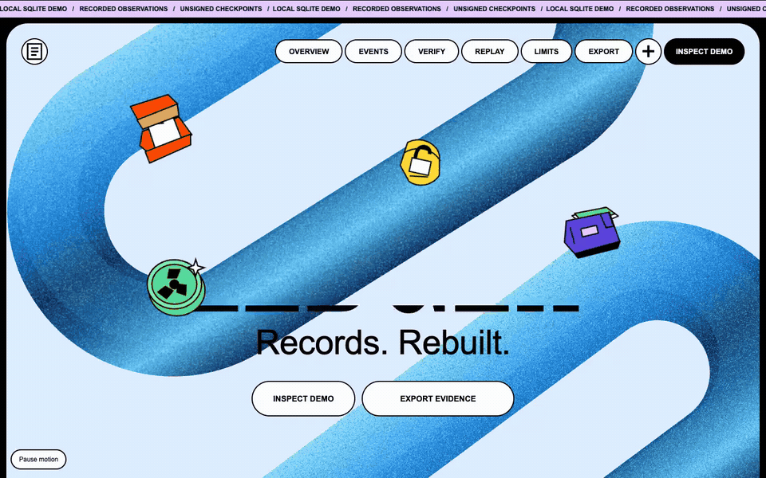

# Agent Audit Ledger

<picture>
  <source media="(prefers-color-scheme: dark)" srcset="docs/how-it-works-dark.svg">
  
</picture>

Use it when you need a small local audit trail for an agent run and want to know two different things: **is the recorded chain internally consistent, and does it still contain the history an independent observer retained?**

## Quickstart

```sh
python3 -m venv .venv && . .venv/bin/activate && pip install .
ledger-audit demo
D=$(mktemp -d) && ledger-audit init --db $D/l.sqlite
ledger-audit append --db $D/l.sqlite --event examples/start.json
ledger-audit verify --db $D/l.sqlite
```

Run from the repository root. The demo needs no network and no arguments; it writes into a fresh temporary directory each time and prints this (about 1 second):

```text
Demo files: /tmp/audit-ledger-demo-1a2b3c/run
Recorded 4 events, wrote and measured 2 files, then tampered with 3 copies:
  payload_changed  detected without checkpoint: hash_mismatch
  middle_deleted   detected without checkpoint: sequence_gap
  tail_truncated   without checkpoint: chain consistent (missing history NOT seen); with checkpoint: truncated_before_anchor
Replay: 1 run(s), 1 finished, 2 artifact(s), 104 bytes
Verdict: PASS - all 3 tamper cases caught as expected; file hashes match
```

The last three commands create a ledger, add one event and verify it:

```text
init done: 0 events, head 2f7380407242
appended event example-start as seq 1 (run_started)
OK    chain consistent, 1 event(s), head 5faeb62031cb
note  no checkpoint given: completeness is unknown (see --checkpoint)
```

The head hashes differ on each run because every ledger gets a fresh ID. Add `--json` to any command for the full machine-readable result on stdout. Exit code 0 means success; verification failures exit 1; bad input or an existing output path exits 2. Without installing, `python3 -m ledger_audit demo` does the same from the repository root.

**Your own data.** An event file is one JSON object: `event_id`, `type` (`run_started`, `artifact_recorded` or `run_finished`) and `payload`. Copy `examples/start.json` and `examples/finish.json`, edit them, append them the same way, then pin a checkpoint and replay:

```sh
ledger-audit checkpoint --db $D/l.sqlite --out $D/checkpoint.json
ledger-audit replay --db $D/l.sqlite --out-db $D/projection.sqlite
```

The checkpoint command prints the digest to retain separately; later `verify --checkpoint $D/checkpoint.json --expected-checkpoint-digest DIGEST` uses it. Repeating an identical event ID and input returns the original record. Reusing the ID for different content fails. An event after a run has finished fails.

## Recorded experiment and viewer

The demo writes and reads two harmless files, records their measured hashes in SQLite, pins a checkpoint, and rebuilds two SQL projections from the events. It then changes a payload, removes a middle event, and removes the final event from separate copies. The last copy remains internally consistent after its head is adjusted. The retained checkpoint detects the missing history.

[Inspect the recorded experiment](docs/index.html) · [Design](docs/design.md) · [Threat model](docs/threat-model.md) · [Research](RESEARCH.md)



[Watch the 21-second interaction recording](docs/showcase.mp4) · [Verification receipt](docs/verification.md)

The animation presents the actual saved experiment. To use the interactive viewer locally:

```sh
python3 tools/serve.py
```

Open `http://127.0.0.1:3410/docs/index.html`. The viewer is self-contained and can also be opened directly as a local HTML file. GitHub's source viewer does not execute HTML.

## What the evidence means

| Check | What it establishes |
| --- | --- |
| `chain: consistent`, `anchor: none` | The stored events, hashes, head and reducer agree with each other. Completeness is unknown. |
| `anchor: exact` | The current head matches the supplied independently retained checkpoint. |
| `anchor: prefix` | The checkpoint's prefix matches; the later tail has no newer independent anchor. |
| SQL replay | The saved events produce the shown state in a newly created SQLite database. No agent or external action is re-executed. |

Anchored verification requires both `--checkpoint FILE` and `--expected-checkpoint-digest DIGEST`. Retain that expected digest through a separately controlled channel **before** investigating a suspected change. Reading it automatically from a neighboring file would not create an independent witness. The demo simulates this separation by keeping the digest in its controller while modifying only its copied databases.

## Saved artifacts, not invented metrics

`examples/recorded/` contains a completed local experiment: source ledger, two projection databases, the two measured files, checkpoint, export, tampered copies and report. Every run creates a fresh ledger ID and real timestamps; the raw SQLite files need not be byte-identical across runs.

```sh
python3 -c 'from pathlib import Path; from ledger_audit.recorded import validate_recorded; v=validate_recorded(Path("examples/recorded")); print(v["demo"]["replay_full"]["counts"])'
```

This validator opens the saved databases read-only. It compares actual SQL rows with the reducer, checks the report against the saved experiment, and checks file hashes and current source hashes. It never appends or reruns the demo.

The inspector displays the two real saved projections. Its controls select evidence; they do not execute ledger commands in the browser. Downloads retain the original JSON bytes.

## Limits

- Python 3.11+ with SQLite 3.31+. No runtime dependencies, model calls, credentials, or network services. `pip install .` only builds this package (it needs `setuptools`).
- Hashes do not authenticate an actor, prove an artifact was possessed, establish trusted time, or stop the file owner rewriting data. An exact anchor does not prove the checkpoint was the newest one. The `actor`, timestamp and observed content digest are declarations.
- At most 1000 events, 16 MiB JSON exports and 32 MiB SQLite files. Explicit SQLite transactions with DELETE journaling and EXTRA synchronization. Inputs use strict closed JSON formats and bounded regular-file reads.
- The CLI never overwrites a target: reuse of an output path exits 2 with `output_exists`. Pick a new path (the demo does this for you).
- The recorded manifest is unsigned: it establishes internal and source consistency, not independent proof that a particular person performed the experiment.
- The test suite covers actual concurrent processes, lost responses, process exits before/after COMMIT, a reader blocking COMMIT, atomic publication races, rehashed tampering, older anchors, import provenance, resource limits and recorded-artifact validation. Injected SQLite API failures test rollback handling; they are not tests of physical power loss or disk failure. See the threat model for the filesystem and single-operator assumptions.
- Run the tests with `python3 -m unittest discover -s tests`.

Code and original fixtures are MIT licensed. The Python interpreter and SQLite retain their own licenses. No private operational workflows or production data are included.
