# System map: agent-audit-ledger

Each diagram shows one real path through this repository. A highlighted box is a step that can reject its input; a vertical bar marks the boundary between zones.

[Back to the README](../README.md)

## Appending an event

ledger-audit append reads one small event file, checks its closed format, scans the whole chain inside a write transaction and only then inserts the record and moves the head. A repeated event ID with the same input returns the original record; the same ID with different input is a conflict.

<picture>
  <source media="(prefers-color-scheme: dark)" srcset="system-map/append-path-dark.svg">
  
</picture>

Source: [`ledger_audit/__main__.py`](../ledger_audit/__main__.py), [`ledger_audit/core.py`](../ledger_audit/core.py), [`ledger_audit/formats.py`](../ledger_audit/formats.py), [`ledger_audit/storage.py`](../ledger_audit/storage.py)

## Verifying a ledger

ledger-audit verify first proves the file is internally consistent, then, if a checkpoint file and its separately retained digest are both given, compares the chain with that anchor. Without an anchor the result says anchor none and completeness stays unknown.

<picture>
  <source media="(prefers-color-scheme: dark)" srcset="system-map/verify-path-dark.svg">
  
</picture>

Source: [`ledger_audit/core.py`](../ledger_audit/core.py), [`ledger_audit/storage.py`](../ledger_audit/storage.py), [`README.md`](../README.md)

## What happens to a tampered ledger

A changed payload fails the hash check and a removed middle event fails the sequence check, both without any checkpoint; a removed final event with adjusted metadata passes the chain check and is caught only by the retained checkpoint. Any failure makes verify exit with code 1.

<picture>
  <source media="(prefers-color-scheme: dark)" srcset="system-map/tamper-detection-dark.svg">
  
</picture>

Source: [`ledger_audit/storage.py`](../ledger_audit/storage.py), [`ledger_audit/core.py`](../ledger_audit/core.py), [`ledger_audit/demo.py`](../ledger_audit/demo.py), [`docs/threat-model.md`](../docs/threat-model.md), [`tests/test_integrity.py`](../tests/test_integrity.py)

## Replaying events into SQL state

ledger-audit replay reduces the verified events to an expected state in pure Python, applies the same events to a newly created SQLite database and refuses to publish it unless the SQL rows equal the reducer output. No agent or external action is run again.

<picture>
  <source media="(prefers-color-scheme: dark)" srcset="system-map/replay-path-dark.svg">
  
</picture>

Source: [`ledger_audit/projection.py`](../ledger_audit/projection.py), [`ledger_audit/reducer.py`](../ledger_audit/reducer.py), [`tests/test_integrity.py`](../tests/test_integrity.py)

## How output files are written

Every file the CLI creates (a new or imported ledger, a checkpoint, an export, a replay projection) is published the same way: refuse an existing path, write a temporary file in the target folder, fsync it and hard link it to the final name. Nothing is ever overwritten.

<picture>
  <source media="(prefers-color-scheme: dark)" srcset="system-map/output-publication-dark.svg">
  
</picture>

Source: [`ledger_audit/files.py`](../ledger_audit/files.py), [`ledger_audit/core.py`](../ledger_audit/core.py), [`tests/test_concurrency.py`](../tests/test_concurrency.py), [`tests/test_publication_recovery.py`](../tests/test_publication_recovery.py)

## Module map

The CLI parses arguments and renders results, formats.py and files.py form the strict input boundary, core.py holds the commands and storage.py with reducer.py validate the chain. projection.py builds the SQL replay, summary.py prints the short text, demo.py and recorded.py run and validate the saved experiment.

<picture>
  <source media="(prefers-color-scheme: dark)" srcset="system-map/module-map-dark.svg">
  
</picture>

Source: [`ledger_audit/__main__.py`](../ledger_audit/__main__.py), [`ledger_audit/formats.py`](../ledger_audit/formats.py), [`ledger_audit/files.py`](../ledger_audit/files.py), [`ledger_audit/core.py`](../ledger_audit/core.py), [`ledger_audit/storage.py`](../ledger_audit/storage.py), [`ledger_audit/reducer.py`](../ledger_audit/reducer.py), [`ledger_audit/projection.py`](../ledger_audit/projection.py), [`ledger_audit/summary.py`](../ledger_audit/summary.py), [`ledger_audit/recorded.py`](../ledger_audit/recorded.py)

## How it is verified

CI runs the unittest suite and the demo on Python 3.11 and 3.14, then runs the viewer tests and rebuilds the viewer from the saved experiment, failing if the committed files differ. The saved experiment in examples/recorded is checked by a read-only validator that never reruns the demo.

<picture>
  <source media="(prefers-color-scheme: dark)" srcset="system-map/verification-dark.svg">
  
</picture>

Source: [`.github/workflows/checks.yml`](../.github/workflows/checks.yml), [`tests/test_concurrency.py`](../tests/test_concurrency.py), [`tests/test_recorded.py`](../tests/test_recorded.py), [`ledger_audit/recorded.py`](../ledger_audit/recorded.py), [`tools/build_showcase.py`](../tools/build_showcase.py), [`docs/verification.md`](../docs/verification.md)
